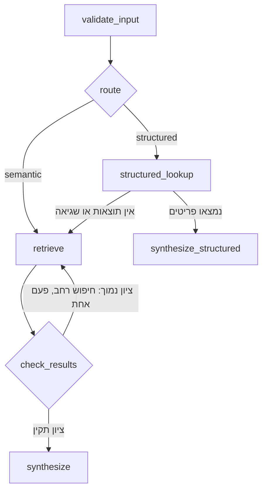
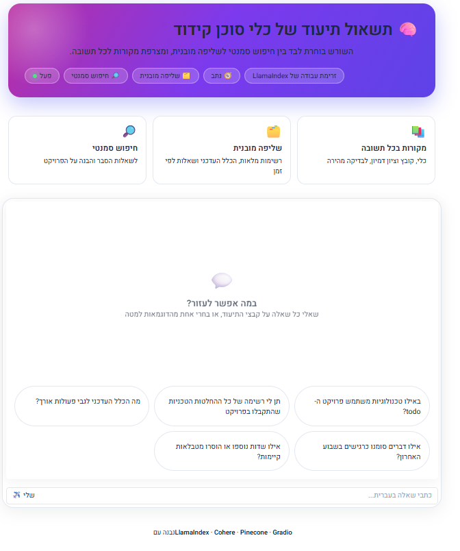
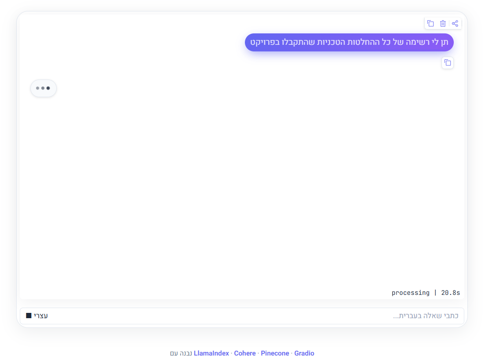
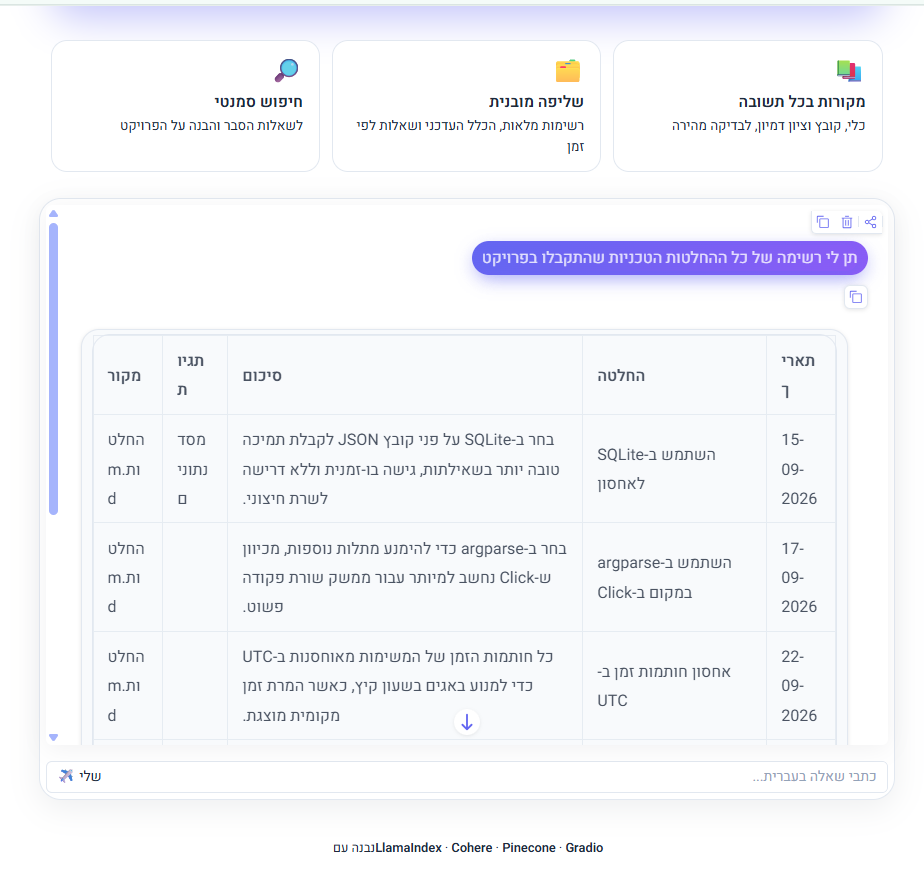
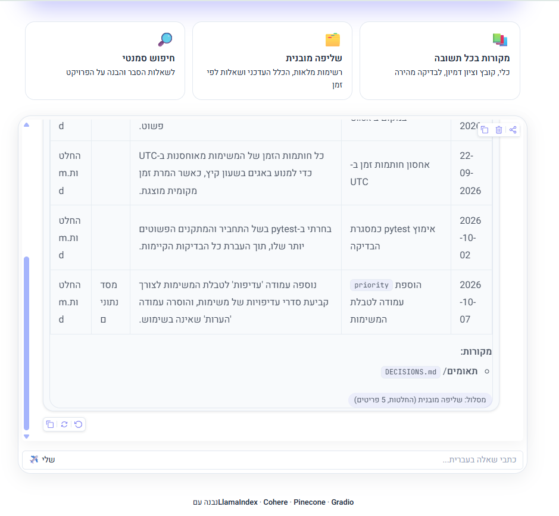
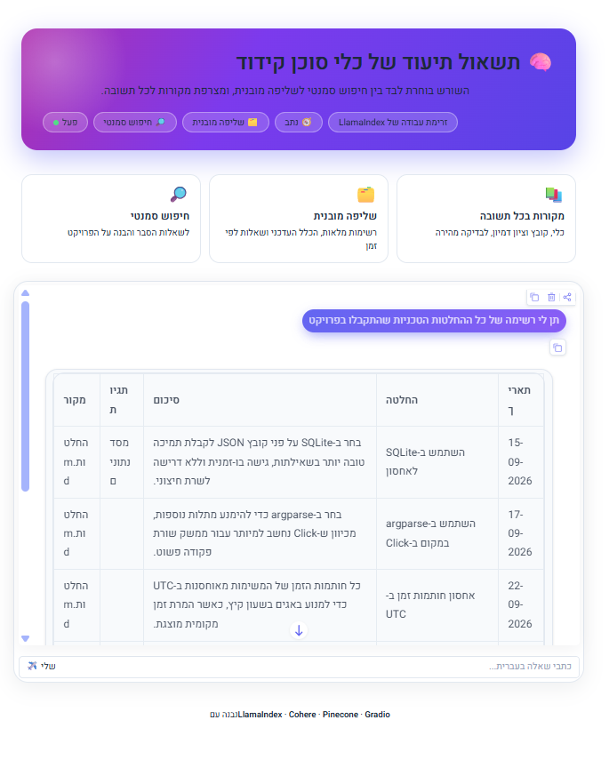
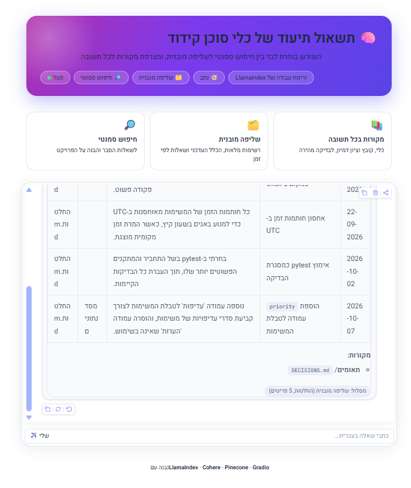

<div align="center">

# 🧠 RAG על תיעוד של כלי Agentic Coding

**שואלים בעברית, והמערכת בוחרת לבד בין חיפוש סמנטי לשליפה מובנית.**


</div>

---

## 📌 תקציר

יישום RAG שסורק את קבצי ה-`md` של כלי קידוד (כרגע **Kiro** ו-**Gemini**), מאגד אותם לשכבת ידע אחת, ומאפשר לשאול עליהם שאלות בעברית דרך צ'אט.

חיפוש סמנטי לבדו לא עונה היטב על שאלות כמו "תן לי את כל ההחלטות" או "מה הכלל העדכני". לכן הפרויקט משלב **שני מסלולי תשובה** ו-**Router** שבוחר ביניהם לפי השאלה.

## ✨ יכולות

| | מסלול | מתאים ל | טכנולוגיה |
|---|---|---|---|
| 🔎 | **חיפוש סמנטי** | שאלות הסבר: "באילו טכנולוגיות משתמש הפרויקט?" | Pinecone + Cohere Embeddings |
| 🗂️ | **שליפה מובנית** | רשימה מלאה, "הכלל העדכני", שאלות לפי זמן | `extracted.json` + סינון בקוד |

- 🧭 **Router אוטומטי** בין שני המסלולים, עם נפילה חזרה לחיפוש סמנטי כשאין תוצאות
- 🔁 **ניסיון חוזר** בחיפוש רחב יותר כשרמת הביטחון נמוכה
- 📚 **מקורות בכל תשובה** (כלי, קובץ, וציון דמיון)
- 🕒 **מודעות לזמן:** כללים `active` מול `superseded`, וסינון לפי "בשבוע האחרון"
- 🌍 **עברית מול מסמכים באנגלית** בעזרת מודל Embedding רב-לשוני

## 🔄 ארכיטקטורה



| שלב | תפקיד | LLM? |
|---|---|---|
| `validate_input` | בדיקת קלט ריק או קצר מדי | ❌ |
| `route` | בחירת מסלול | ✅ |
| `retrieve` | חיפוש וקטורי (רגיל או רחב) | ❌ |
| `check_results` | בדיקת confidence וניסיון חוזר | ❌ |
| `structured_lookup` | תרגום השאלה לשאילתה, וסינון בקוד Python | ✅ |
| `synthesize` / `synthesize_structured` | ניסוח התשובה עם מקורות | ✅ |

תרשים מלא שנוצר אוטומטית: [`workflow_all_flows.html`](workflow_all_flows.html)

### 💭 החלטות עיצוב

- **כל Step מקבל החלטה אחת.** שלבים שאינם דורשים הבנת שפה (תקינות, אחזור, בדיקת איכות) הם לוגיקה רגילה, בלי LLM.
- **State** נדרש בגלל לולאת הניסיון החוזר, ונשמרים בו `original_query`, `retries` ו-`route`.
- **Event מול State:** ב-Event עובר מה שהשלב הבא צריך מיד (שאילתה, תוצאות). ב-State נשמר מה שחוצה כמה שלבים.
- **סינון בקוד, לא ב-LLM:** ה-LLM רק מתרגם שאלה לשאילתה (סוג, סטטוס, חומרה, כלי, טווח ימים), והסינון עצמו דטרמיניסטי.

## 🧱 שכבת הנתונים המובנית

`extract.py` מחלץ ארבעה סוגי פריטים מכל קובץ:

`decisions` · `rules` · `warnings` · `schema_changes`

לכל פריט יש מזהה, מקור (כלי, קובץ, כותרת סעיף) ותאריך `observed_at`. לכללים יש גם `status` (`active` או `superseded`), וכך אפשר לענות על "מה הכלל העדכני".

## 🚀 התחלה מהירה

**דרישות:** Python 3.12+, [uv](https://docs.astral.sh/uv/), וחשבונות ב-[Cohere](https://cohere.com) וב-[Pinecone](https://www.pinecone.io).

```bash
# 1. התקנה
uv sync

# 2. מפתחות: מעתיקים את התבנית וממלאים
cp .env.example .env

# 3. הכנת הנתונים (פעם אחת, או כשהקבצים משתנים)
uv run prepare.py
uv run extract.py

# 4. הפעלת הצ'אט
uv run workflow_agent.py
```

ואז פותחים **http://127.0.0.1:7861**

> 💡 אם משנים את קבצי ה-md, מוחקים את ה-namespace ב-Pinecone לפני הרצה חוזרת של `prepare.py`, כדי שלא יישמרו כפילויות.

### משתני סביבה

| משתנה | חובה | תיאור |
|---|---|---|
| `COHERE_API_KEY` | ✅ | מפתח Cohere (Embeddings ו-LLM) |
| `PINECONE_API_KEY` | ✅ | מפתח Pinecone |
| `DISABLE_SSL_VERIFY` | ❌ | `1` מכבה אימות SSL. לפיתוח מקומי מאחורי סינון רשת בלבד, **לא לייצור** |

## ❓ שאלות לדוגמה

| שאלה | מסלול |
|---|---|
| באילו טכנולוגיות משתמש פרויקט ה-todo? | 🔎 סמנטי |
| למה נבחר SQLite ולא קובץ JSON? | 🔎 סמנטי |
| תן לי רשימה של כל ההחלטות הטכניות שהתקבלו בפרויקט | 🗂️ מובנה |
| מה הכלל העדכני לגבי אורך פונקציה? | 🗂️ מובנה |
| אילו דברים סומנו כרגישים בשבוע האחרון? | 🗂️ מובנה |
| אילו שדות נוספו או הוסרו מטבלאות קיימות? | 🗂️ מובנה |

## 📁 מבנה הפרויקט

```
.
├── prepare.py              # טעינה, חיתוך, Embedding ושמירה ב-Pinecone
├── agent.py                # שלב א': צ'אט RAG פשוט
├── extract.py              # שלב ג': חילוץ מובנה ל-extracted.json
├── workflow_agent.py       # שלבים ב' ו-ג': Workflow עם Router
├── draw_workflow.py        # יצירת תרשים ה-Workflow
├── ssl_dev.py              # כיבוי SSL אופציונלי לפיתוח מקומי
├── extracted.json          # פלט החילוץ המובנה
├── workflow_all_flows.html # התרשים שנוצר
├── Kiro-steering/          # קבצי md של Kiro
├── Gemini-md/              # קבצי md בסגנון Gemini CLI
├── .env.example
└── pyproject.toml
```

## 🛠️ מה למדתי בדרך

- **מודל ה-Embedding קובע הרבה.** המעבר ל-`embed-multilingual-v3.0` העלה את ציוני הדמיון בשאלות בעברית מכ-**0.23** לכ-**0.5**.
- **מודל שפה לא עומד בסכמה בצורה אמינה.** הוא החזיר שמות שדות שונים ו-`null` במקום רשימה. הפתרון: לבקש JSON עם דוגמה, ולנרמל את התשובה בקוד.
- **לא כל שלב צריך LLM.** רוב ה-Workflow הוא לוגיקה רגילה, וזה מה שהופך אותו לצפוי ובדיק.

## ⚠️ מגבלות ידועות

- ה-Router בוחר **מסלול אחד** בכל שאלה. שאלה שדורשת גם הסבר וגם רשימה מלאה תקבל רק אחד מהם.
- איכות המסלול המובנה תלויה בחילוץ של מודל השפה, ולכן כדאי לעבור על `extracted.json` אחרי כל הרצה.
- שינוי בקבצי ה-md לא מתעדכן אוטומטית באינדקס, וצריך להריץ מחדש את `prepare.py` ו-`extract.py`.

## 🗺️ שדרוגים אפשריים

- [ ] חילוץ מחדש רק של קבצים ששונו (לפי hash)
- [ ] סנכרון אוטומטי בין הקבצים לאינדקס
- [ ] Router שמפעיל את שני המסלולים יחד

## 📝 הערות

- קבצי `Gemini-md/` נכתבו ידנית (בעזרת מודל שפה) בסגנון Gemini CLI, כי ההתחברות החינמית ל-Gemini CLI נחסמה. הם אינם פלט של הכלי עצמו.
- קבצי `Kiro-steering/` לקוחים מפרויקט דוגמה חיצוני ("Spirit of Kiro") ומשמשים כנתוני בדיקה בלבד. יש לכבד את הרישיון של המקור.
- שם האינדקס (`first`) וה-namespace (`agentic-docs-multi`) מוגדרים ב-`prepare.py`, `agent.py` ו-`workflow_agent.py`, וחייבים להיות זהים בכולם.








